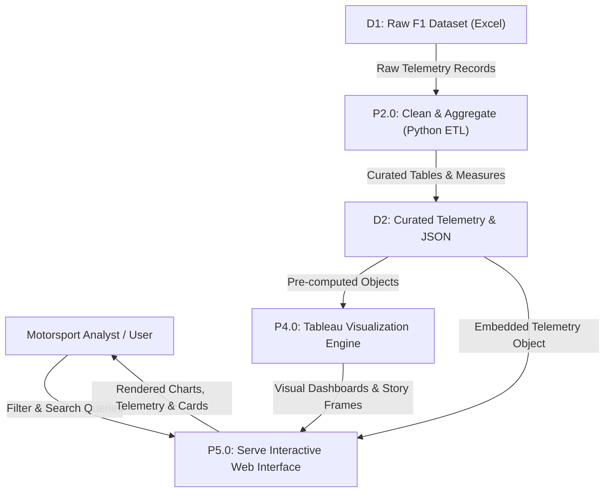

# Requirement Analysis Phase
## Data Flow Diagram & User Stories

| Metadata Field | Project Information |
| :--- | :--- |
| **Date** | 31 January 2026 / October 2026 |
| **Author / Team ID** | Samriddhi Shrivastava |
| **Project Name** | Formula 1 Race Intelligence |
| **Maximum Marks** | 4 Marks |

---

### Data Flow Diagram (DFD) Specification

#### DFD Symbol Legend
* **External Entity (Oval / Rounded):** Race Strategist, Motorsport Fan, FIA Telemetry Feed.
* **Process (Rectangle with Header):**
  * `P1.0`: Ingest & Validate Raw Dataset (Excel / CSV).
  * `P2.0`: Transform, Clean & Normalize Telemetry Data (Python ETL / Snowflake SQL).
  * `P3.0`: Compute Aggregates, KPIs & Predictive Indices.
  * `P4.0`: Render Tableau BI Dashboards & Story Points.
  * `P5.0`: Serve Responsive Web Interface (HTML5/CSS3/ES6+).
* **Data Store (Open Rectangle):**
  * `D1`: Raw Racing Data Store (6,464 race results, 3,814 lap records).
  * `D2`: Curated Telemetry Store (Cleaned drivers, circuits, teams).
  * `D3`: Data Store JS (`data.js` / JSON endpoints).
* **Data Flow (Labeled Arrow):** Telemetry metrics, aggregated points, filtered driver subsets.

---

### User Stories & Acceptance Criteria

| User Type | Functional Epic | USN | User Story / Task | Acceptance Criteria | Priority | Sprint |
| :--- | :--- | :---: | :--- | :--- | :---: | :---: |
| Race Analyst | Telemetry Overview | **USN-01** | As an analyst, I want to view top-level KPIs (Teams, Seasons, Outcomes, Circuits) immediately upon landing. | Display Competing Teams (10), Seasons (17), Outcomes (6,464), and Circuits (29) with animated count-up. | High | Sprint-1 |
| Race Strategist | Tire Intelligence | **USN-02** | As a strategist, I want to analyze Pirelli compound usage distribution across telemetry laps. | Render Doughnut chart showing Soft 31.52%, Medium 30.78%, Hard 30.36%, and Inter 7.34% with lap counts. | High | Sprint-1 |
| Team Principal | Constructor Standings | **USN-03** | As a team principal, I want to compare total constructor championship points across all 10 active teams. | Horizontal bar chart ranking Red Bull (8,006), Mercedes (7,790), Ferrari (5,778), McLaren (4,270), etc. | High | Sprint-1 |
| Race Engineer | Reliability Analytics | **USN-04** | As a race engineer, I want to inspect DNF causes by driver to assess mechanical vs collision failure rates. | Stacked bar chart categorizing Mechanical, Collision, Engine, Gearbox, and Electrical retirements per driver. | High | Sprint-2 |
| Data Journalist | Storytelling Navigation | **USN-05** | As a journalist, I want a multi-chapter story navigator to present race intelligence narrative to audiences. | Clickable story point chips (1 to 7) that dynamically update narrative commentary below the Tableau frame. | Medium | Sprint-2 |
| Motorsport Fan | Driver Grid Exploration | **USN-06** | As a fan, I want to search and filter drivers by season and sort by points, wins, and podiums. | Live search input and season dropdown (Career, 2026, 2025, 2024...) updating driver cards instantly. | High | Sprint-2 |
| Simulation Driver | Circuit Dynamics | **USN-07** | As a simulation driver, I want to visualize track geometry with sector marks (S1, S2, S3) and DRS zones. | Animated SVG circuit path with red dashed racing line and glowing traveling car indicator. | Medium | Sprint-1 |
| General User | Inquiry Transmission | **USN-08** | As a visitor, I want to transmit an inquiry through a styled contact form and receive immediate confirmation. | Client-side validation for name, email, message, and animated toast confirmation upon submission. | Low | Sprint-2 |
