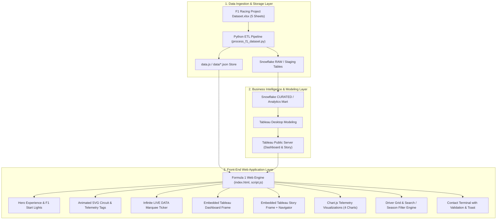

# Project Design Phase
## Solution Architecture

| Metadata Field | Project Information |
| :--- | :--- |
| **Date** | 19 September 2026 / October 2026 |
| **Author / Team ID** | Samriddhi Shrivastava |
| **Project Name** | Formula 1 Race Intelligence |
| **Maximum Marks** | 4 Marks |

---

### High-Level Architecture Overview
The **Formula 1 Race Intelligence** platform employs a decoupled, high-performance data architecture separating raw ingestion, analytical data warehousing, visualization modeling, and client presentation.

---

### Component Description Table

| Component Name | Description / Role in Architecture | Technology Used |
| :--- | :--- | :--- |
| **Source Workbook** | Primary historical repository comprising 6,464 race outcomes, 3,814 telemetry laps, 3,130 qualifying records, 311 standings, and 29 circuits. | Microsoft Excel (.xlsx) |
| **ETL Pipeline** | Automated Python pipeline that reads openpyxl workbooks, cleans encoding anomalies, filters synthetic placeholders, and outputs normalized JSON. | Python 3.13, OpenPyXL |
| **Data Warehouse** | Multi-tier cloud data warehouse structuring RAW ingestion tables, normalized STAGING views, and CURATED reporting marts. | Snowflake Cloud DW / SQL |
| **Offline Data Store** | Synchronously loaded JavaScript data object providing zero-CORS offline execution when double-clicking `index.html`. | Vanilla JavaScript (`data.js`) |
| **Tableau BI Engine** | Cloud-hosted multi-panel dashboard and narrative story points delivering deep-dive visual analytics. | Tableau Public Embed API / iFrame |
| **Inline Visual Engine** | Client-side canvas charting rendering high-speed bar, doughnut, and stacked failure charts. | Chart.js 4.4 |
| **Vector Animation Engine** | Hardware-accelerated SVG circuit mapping with traveling red car dot, S1–S3 sector marks, and DRS straight bar. | Pure SVG & CSS Keyframes |
| **Web Presentation Engine** | Semantic HTML5 single-page application styled in strict F1 Black & Red broadcast theme (`#0a0a0a` + `#e10600`). | HTML5, CSS3, Vanilla JS ES6+ |
