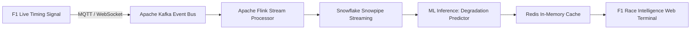

# Project Demonstration Phase
## Scalability & Future Plan

| Metadata Field | Project Information |
| :--- | :--- |
| **Date** | October 2026 |
| **Author / Lead Architect** | **Samriddhi Shrivastava** |
| **Project Name** | Formula 1 Race Intelligence |
| **Deliverable** | Architecture Scalability & Future Roadmap |

---

### Architectural Scalability Framework
The **Formula 1 Race Intelligence** platform is engineered to scale from its current static and local deployment into an enterprise-grade, real-time live telemetry infrastructure:

---

### Multi-Phase Future Roadmap

| Milestone | Phase Title | Technical Capabilities & Deliverables | Target Horizon |
| :---: | :--- | :--- | :---: |
| **Phase A** | **Real-Time Live Timing API Streaming** | Integrate official F1 Live Timing WebSocket streams (via FastF1 / Ergast APIs) to stream sector times and speed traps with sub-second latency. | Q1 2027 |
| **Phase B** | **Machine Learning Predictive Stint Modeling** | Deploy XGBoost and Random Forest regression models to forecast tire degradation rates, lap-time drop-offs, and optimal pit stop laps under safety car conditions. | Q2 2027 |
| **Phase C** | **3D WebGL Circuit Visualizer** | Upgrade 2D SVG track maps to interactive Three.js / WebGL 3D circuit models with dynamic vehicle coordinates and brake/throttle heatmaps. | Q3 2027 |
| **Phase D** | **Cloud Containerization & Global CDN** | Package platform into Docker microservices deployed across AWS ECS / Fargate with CloudFront global edge caching for international fan communities. | Q4 2027 |
| **Phase E** | **Team Strategy Simulator & What-If Engine** | Provide race engineers with an interactive simulation sandbox to test alternative undercut/overcut pit strategies against historical competitor telemetry. | Q1 2028 |
